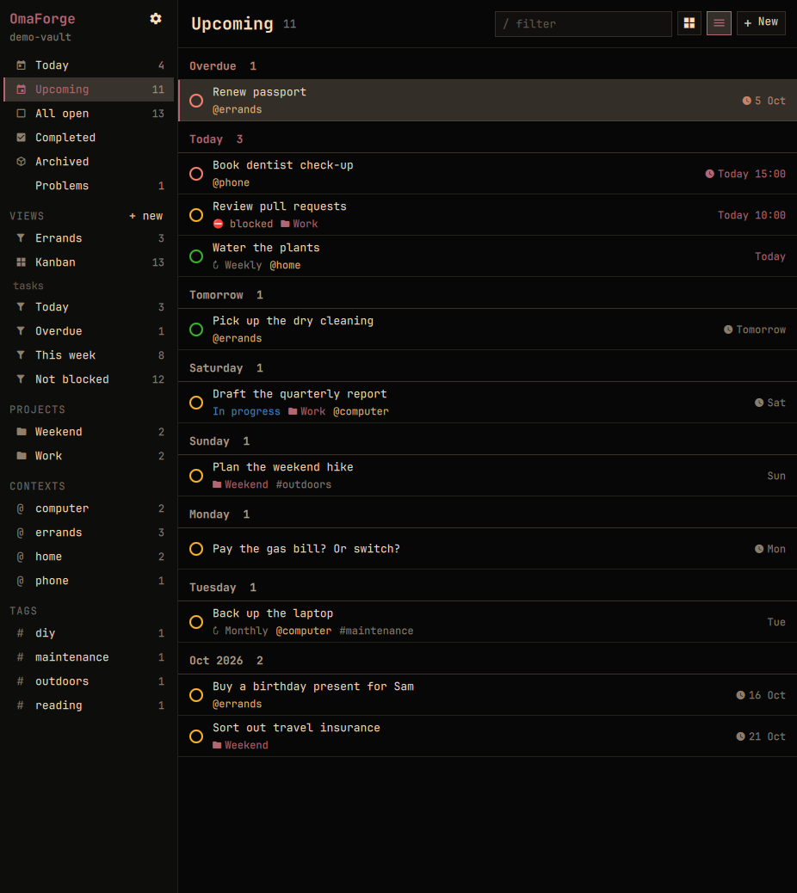
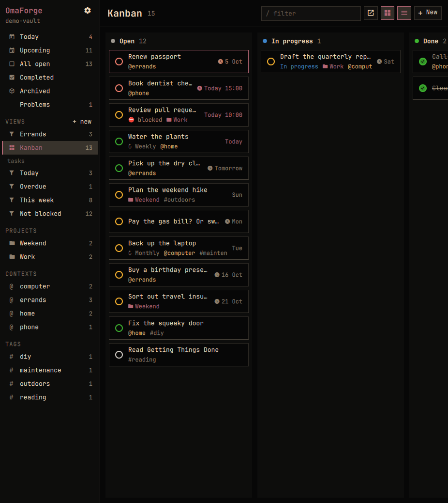
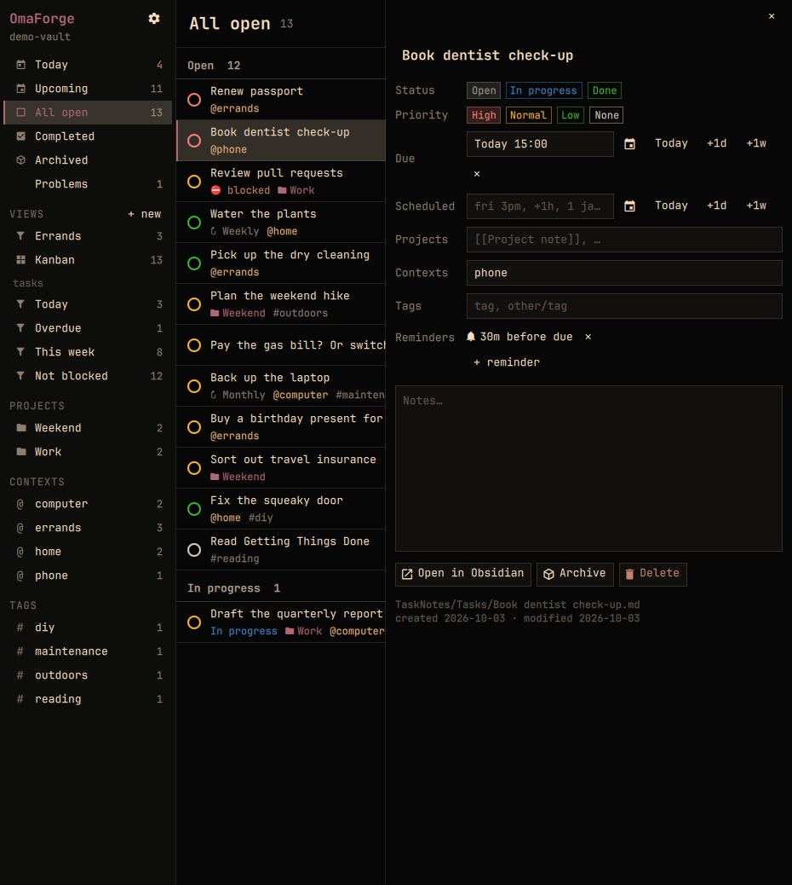

# OmaForge

A native [Omarchy](https://omarchy.org) app for [TaskNotes](https://github.com/callumalpass/tasknotes)
tasks (one Markdown note per task in an Obsidian vault), or for
[Obsidian Tasks](https://github.com/obsidian-tasks-group/obsidian-tasks)
checkbox lines. It's a keyboard-first
list/board manager in the spirit of [TaskForge](https://taskforge.md/), built on
Quickshell so it looks and behaves like the rest of Omarchy.

The vault is the only state. OmaForge reads and writes the notes directly, as
TaskNotes itself would, so Obsidian (and any sync service) see its changes as
ordinary edits. Obsidian doesn't need to be running.

If you dig this, you may also enjoy [this bar widget plugin thing](https://github.com/Doghouse-Mike/omatasknotes).



> [!WARNING]
> **OmaForge edits your notes directly, and it could damage your vault.** A lot of care
> has gone into not doing that (see [How it stays safe](#how-it-stays-safe-with-your-vault)),
> but this is a young project with one main user. **Back up your vault, several
> times and in several places, before pointing OmaForge at anything you care
> about,** and try the [demo vault](#try-it-without-risking-anything) first.
> Vaults open read-only until you explicitly allow writes.

## Where we're at

October 2026: an early, personal project, built in about a week and used daily
on one real vault. It's here to show what a native Omarchy client could look
like, not as a finished product.

- **Only tested on [Omarchy](https://omarchy.org)** (Arch + Hyprland, with its
  Quickshell-based desktop). It should run anywhere Quickshell does, but it
  takes its colours and fonts from Omarchy's theme files, and nothing else has
  been tried.
- **TaskNotes is the format that's dogfooded.** I use OmaForge daily on a
  TaskNotes vault. [Obsidian Tasks](#tasknotes-or-tasks) lines are supported
  too and checked against the Tasks plugin itself, but they get far less
  real-world use, so expect rougher edges there. Bug reports are very welcome.
- **English only.** Dates, repeat rules ("every 2 weeks on Friday") and the
  interface are all in English, and nothing has been localised yet.
  Volunteers are welcome.
- The official [TaskForge](https://taskforge.md/) covers much more, including
  Dataview and Task Genius syntaxes, calendars, a notes editor and mobile.
  None of that is here.
- **Works:**
  - Today, Upcoming, All open, Completed and Archived lists, plus projects,
    contexts and tags
  - list and board layouts, and a full task editor
  - repeating tasks: complete or skip an occurrence, and set the repeat in
    plain English ("every weekday", "every 2 weeks on fri", "monthly on the
    1st", "every last friday")
  - "blocked by" dependencies, set with a task picker, plus a "Blocking" list
  - archive and delete (to the trash)
  - your Obsidian **Bases** views (`.base` files) evaluated live, and a view
    editor that writes new ones
  - right-click menus: status, priority, dates, move to project, blocked by,
    duplicate, copy as Markdown, archive and more
  - natural-language dates and times with a calendar picker
  - **notifications** for TaskNotes reminders, timed tasks, a morning summary
    and an overdue nudge
  - keyboard-driven throughout: Ctrl+Tab moves between the lists, the tasks
    and the open task (Ctrl+Shift+Tab back)
- **Not yet:**
  - calendar grids
  - time tracking and pomodoro
  - editing hand-made `.base` views in place (duplicating them into editable
    copies works)
  - manual drag ordering
  - quick-add parsing of whole sentences (dates are parsed; titles aren't)
  - translations (English only so far)
- **How it's checked:** OmaForge's writes are diffed against TaskNotes 4.13.8
  itself, running in Obsidian, for 33 operations. Its views are compared with
  Obsidian's own Bases engine across 198 cases, their sort order across 32,
  and their grouping across 12. Tasks support is compared with the Tasks
  plugin (8.5.0): every task in a 600-task vault is read the same,
  37 sample lines are written and ticked the same, and 245 ` ```tasks `
  queries give the same tasks in the same order and groups. There are unit tests for the
  YAML editing, the operations, notifications and the date reader. See
  [Matching TaskNotes exactly](#matching-tasknotes-exactly).

Built with a lot of help from [Claude Code](https://claude.com/claude-code).

## Try it without risking anything

Not running Omarchy? [tryomarchy.com](https://tryomarchy.com/) lets you have a
play with it without doing a full OS install.

Then, on Omarchy:

```bash
git clone https://github.com/Doghouse-Mike/omaforge && cd omaforge
bin/omaforge --demo
```

`--demo` copies the bundled [demo vault](demo-vault/) (made-up tasks, projects
and views) to `~/.local/state/omaforge/demo-vault`, filling in dates relative
to today, and opens that copy with editing allowed. Break it freely;
`bin/omaforge --demo --reset` gives you a fresh copy. It doesn't touch your
config or any other vault. Close a running OmaForge (Ctrl+Q) first.
`bin/omaforge --demo --tasks` shows the demo in Obsidian Tasks format instead
(checkbox lines in `Tasks format/`, and a dashboard of ` ```tasks ` queries),
for that run only.

| | |
|---|---|
|  |  |

## Install

```bash
./install.sh            # ~/.local/bin/omaforge, app-menu entry, icon
```

Then edit `~/.config/omaforge/config.json`:

```json
{
  "vault": "~/Documents/My Vault",
  "writableVaults": ["~/Documents/My Vault"]
}
```

**A vault opens read-only unless it's listed in `writableVaults`.** That's
deliberate: pointing OmaForge at a vault never changes it until you opt in.

Run `omaforge` (or pick it from the app menu). A second launch raises the
running window. `omaforge --vault PATH` overrides the config for one run.
Nothing to install first on Omarchy: it needs `quickshell` and `python-yaml`,
which a standard install already has (`python-yaml` comes in with `udiskie`).

Want a key for it? Add a binding in `~/.config/hypr/bindings.lua` that runs
`omaforge`, the same way as your other app launchers.

## Using it

Sidebar: **Today** (due or scheduled on or before today), **Upcoming** (grouped by
day), **All open**, **Completed**, **Archived**, plus your TaskNotes saved views,
projects, contexts and tags. **Problems** lists notes in the task folders whose
properties don't parse. They're shown read-only, since TaskNotes can't read them
either.

| Key | |
|---|---|
| `j` / `k` | next / previous task |
| `[` / `]` | previous / next list |
| `1`–`5` | Today, Upcoming, All open, Completed, Archived |
| `x` / space | complete; for a repeating task, completes the current occurrence |
| `s` / `S` | next / previous status |
| `+` / `-` | raise / lower priority |
| `n` | new task, which inherits the current project, context or tag. In Today it's scheduled today |
| `/` | filter |
| `b` | list ↔ board (drag cards between status columns) |
| `e` / Enter | edit (in narrow windows the editor slides over the list) |
| `d` | toggle the editor pane |
| `o` | open the note in Obsidian |
| `?` | key help |

### Views

The sidebar's **Views** lists every task view in your vault's Obsidian Bases
(`.base`) files: TaskNotes' own Today, Overdue, This Week, Kanban, Agenda and
so on, plus any you've made. They're evaluated live, with the same results
Obsidian gives, in the same order and groups (`tools/basestest.py` checks
198 cases, 32 sort orders and 12 groupings against Obsidian itself). Kanban views open
as a board, and calendar-style views as a list grouped by date. Views that
only make sense next to a note open in
Obsidian (the relationship views) are left out. Anything else OmaForge can't
evaluate is shown dimmed with the reason, never with a wrong result.

**+ new** builds a view: conditions on status, priority, dates, projects,
contexts, tags, title, archived or repeating, matched all or any, plus sort,
grouping and list or board. It's saved as its own `.base` file in
`TaskNotes/Views`, so it's an ordinary Obsidian Bases view too: it syncs, and
it opens in Obsidian. Views made this way can be edited and deleted from
OmaForge (**✎ Edit view**). Views you built by hand in Obsidian are never
rewritten: OmaForge only touches a `.base` file it can regenerate exactly,
so a rewrite can't lose anything. For any other view, **Edit view** and
**Delete view** are greyed out ("can't rewrite safely"). That includes a
view made in OmaForge and later changed in Obsidian in a way OmaForge
doesn't model, such as an extra view in the same file or a column change.
This is deliberate, not a bug: duplicate it (below) or edit it in Obsidian.
TaskNotes' older saved views (from its settings) are listed read-only.

To change a hand-made view (TaskNotes' own Today, Overdue and so on),
right-click it and pick **Duplicate as editable view**. The copy starts out
identical to the original. Conditions the editor has controls for become
normal rows. Anything else (nested and/or groups, formulas, a multi-key
sort) is kept exactly as written: you can remove it, but you edit it in
Obsidian. Only the formulas the view uses are copied. `tools/basestest.py`
checks that Obsidian shows the same tasks, in the same order, for every
view and its copy.

### TaskNotes or Tasks

OmaForge works with one task format at a time, chosen under the gear
(**Task format**):

- **TaskNotes**: one note per task, with YAML properties. This is everything
  described above.
- **Tasks** (the [Obsidian Tasks](https://github.com/obsidian-tasks-group/obsidian-tasks)
  plugin): a task is a checkbox line inside any note, e.g.
  `- [ ] Pay rent 📅 2026-11-01`. Both the emoji and Dataview (`[due:: …]`)
  formats are read, and lines are written back in the format your Tasks
  settings use. The sidebar groups tasks by the note they live in. Dates
  have no times in Tasks, and there are no reminders. Completing a repeating
  task adds the next occurrence's line, as Tasks does. New tasks go to
  today's daily note if it exists, otherwise to an inbox note you choose
  (OmaForge never creates daily notes, since they may use templates).
  Tasks has no "skip occurrence", so neither does this mode.
- **Queries**: every ` ```tasks ` block in your notes appears in the sidebar
  under **Queries**. Each is named after the heading it sits under, and shows
  the same tasks as the block does in Obsidian, in the same order and groups.
  The filters, boolean combinations, sorting, grouping, limits, presets and
  the global query all follow Tasks 8.5.0 (`docs/tasks-query-spec.md`).
  Natural-language dates ("next friday", "in two weeks", "14 October", two
  dates as a range) are read by the same chrono-node version Tasks bundles,
  vendored as `app/chrono.js` (MIT).
  `view columns by …` shows the query as a board, one column per group, with
  any further `group by` levels as headings inside the columns. As in Tasks,
  dragging a card between columns edits it when the columns are by priority
  or by a date (due, scheduled, start, created, done, cancelled). Dropping on
  "No due date" removes the date, and other columns are display-only.
  A note's properties work as in Tasks: its `TQ_*` "query file defaults"
  (`TQ_extra_instructions`, `TQ_short_mode` and so on) apply to every query in
  the note, and `{{query.file.property('x')}}` reads them.
  A query that Tasks itself would reject is
  shown dimmed with the reason, never with a guessed answer. JavaScript in
  queries (`filter by function` and so on) is off by default in Tasks too,
  so those lines are errors.

**Auto** (the default) uses TaskNotes when that plugin is enabled in the
vault, and Tasks otherwise.

### Notifications

A small background service, `omaforge-notify` (a systemd user service that
`install.sh` sets up), sends desktop notifications even when the window is
closed. The gear next to the OmaForge title switches and tunes each kind:

- **Reminders**: TaskNotes' own `reminders:` (add them under the task pane's
  **Reminders**). They follow TaskNotes' rules: each reminder fires once, up
  to a day late after sleep or a reboot, and never for a completed task or
  occurrence.
- **Tasks with a time**: a due or scheduled time like `14:00` notifies then,
  optionally some minutes early.
- **Morning summary** and **overdue nudge**: once a day each, at set times.

Reminder notifications have **Done** (completes the task, or the current
occurrence of a repeating task), **Snooze** and **Open**. Turn notifications
off in TaskNotes' own settings, or you'll get two of each while Obsidian is
open. The service's log is at `journalctl --user -u omaforge-notify`.

### Dates and times

Date boxes take what you'd naturally type, and show what they understood
before you press Enter ("→ Fri 1 Jan 2027, 09:00"):

| You type | Means |
|---|---|
| `fri`, `next fri`, `tomorrow`, `next week`, `weekend`, `end of month` | that day (`fri` = the coming Friday, today included) |
| `January 1st 2027`, `1 Jan`, `jan 1`, `1/2/27`, `2027-01-01`, `the 15th` | that date (UK order: 1/2 is 1 February) |
| `3pm`, `15:30`, `noon`, `tonight` | that time, today if it's still ahead, else tomorrow |
| `fri 3pm`, `tomorrow at noon`, `1 jan 14:00` | date and time |
| `+10m`, `+1h`, `in 2 hours` | that long from now |
| `+3d`, `+1week at 1pm`, `in 2 weeks 9am` | days or weeks from today, optionally at a time |
| `fri all day` | a date with no time |

A date without a time gets your **default time** (09:00 unless changed under
the gear; it can be switched off). ↓ or the calendar button opens a picker:
arrows move a day or week, PgUp and PgDn move a month, `t` jumps to today,
`n` means no time, digits type a time, and Enter sets it. The quick time
buttons offer your default, 12:00, 15:00 and 18:00.

`node tools/dates-test.mjs` runs the date reader against a fixed clock.

### Repeats

The task pane's **Repeats** box reads rules in plain English. It shows what it
understood as you type, and ▾ offers the common ones:

| You type | Becomes |
|---|---|
| `daily`, `every 3 days`, `weekdays`, `weekends` | every day / 3 days / Mon–Fri / Sat–Sun |
| `every monday`, `every mon and thu`, `every 2 weeks on fri`, `fortnightly` | weekly patterns |
| `monthly on the 1st`, `every 15th`, `last day of the month`, `every last friday`, `every first monday` | monthly patterns |
| `every year on 1 jan`, `annually on 25 december` | yearly |
| `… until 1 jan 2027`, `… for 10 times`, `weekly x5` | an end date or a count |
| `none` | stop repeating |

Setting a repeat follows TaskNotes' own rules: the task is scheduled for the
first matching day from today, due moves with it, and completed occurrences
are kept. **Next one counts from** chooses whether the next occurrence follows
the schedule or the day you actually complete it.

## How it stays safe with your vault

- **Line-level edits.** A change rewrites only the lines of the fields it
  touches. Key order, quoting, comments, line endings and the note body come
  back byte-for-byte. (`core/tests`; every note of a ~4,200-note vault
  round-trips unchanged.)
- **Compare-and-swap.** Every edit carries the value the UI showed. If that
  field changed on disk in the meantime (Obsidian, Sync, your phone), the
  write is refused and the fresh version is shown. Changes to *other* fields
  aren't conflicts. Note bodies are checked against the whole file.
- **Never guess.** Notes with invalid YAML are never written. Unreadable
  TaskNotes settings mean read-only. A missing file is reported, not
  recreated. Deletes go to the trash (system trash, or the vault's `.trash`
  if Obsidian is set to use it), never a permanent delete.
- **Renames don't break links.** With titles stored in filenames, TaskNotes
  renames the note and Obsidian rewrites links to it. OmaForge can't do that
  rewriting, so if anything links to the note it keeps the filename and stores
  `title:` instead. TaskNotes treats both the same.
- **Atomic writes.** Each write goes to a temp file, is fsynced, then renamed into place.

## Matching TaskNotes exactly

`docs/tasknotes-spec.md` is the on-disk behaviour of TaskNotes 4.13.8, taken
from its source: identification, filenames, key order, timestamps,
recurrence, archiving and YAML style. Where the spec and the live plugin
disagreed, the plugin won (noted in code).

`tools/difftest.py` checks this against the real plugin. TaskNotes, running
inside Obsidian on the test vault, performs each operation on one copy of a
note while OmaForge performs it on another, and the results must match. TaskNotes
must also read OmaForge's copy back. Covered: complete and uncomplete,
statuses, priority, dates, contexts, projects, tags, archive and unarchive,
recurring complete, skip and uncomplete (both anchor types), and create,
including odd titles, recurrence and filename collisions.

```bash
cd core && python3 -m unittest            # unit tests (synthetic temp vaults)
node tools/dates-test.mjs                 # the date reader, against a fixed clock
node tools/recur-test.mjs                 # the repeat-rule reader

# These two drive TaskNotes and Obsidian through the Obsidian CLI. Use a
# throwaway copy of a vault, open in Obsidian:
export OMAFORGE_TEST_VAULT=~/Documents/some-disposable-vault-copy
python3 -I tools/difftest.py
python3 -I tools/basestest.py
python3 -I tools/taskstest.py             # needs the Tasks plugin enabled too
python3 -I tools/tasksquerytest.py        # ```tasks queries, same
```

The Obsidian CLI quietly runs commands in whichever vault window was used
last, not the one you name, so `tools/obsidian-test` checks which vault
Obsidian will act on before every call and refuses if it's the wrong one.

`tools/basestest.py` does the same for views. It seeds edge-case tasks,
asks Obsidian's own Bases engine which notes each view and expression
matches, and compares that with OmaForge's evaluator (`app/bases.js`, run
under node). Obsidian's engine has some surprises the evaluator copies on
purpose. For example, `!x` of a missing property is no match (null), not
true, so the editor writes "doesn't include" as `… != true` to keep tasks
with no value.

It also checks order and grouping. Every view with a sort or grouping, plus
extra sorts and groupings, is opened in Obsidian, and the rendered view's
`groupedData` is compared with the app's own `computeBase`. That's the order
you actually see. `base:query` isn't used for order, because it differs from
the view in places.

What it established:
- A sort on a note property that no task in the view has is ignored. That
  covers TaskNotes' `tasknotes_manual_order` before anything has been
  dragged, or `completedDate` in a list of open tasks.
- With no sort left, rows are listed by file name.
- Rows with equal sort values fall back to the full path, ascending in
  either direction.
- `file.name` sorts without its extension.
- Empty values sort last, and the empty group stays last even when groups
  are descending.
- A date and a date-with-time on the same day share a group.
- `min`, `max` and `number` of an empty value are empty, so a formula like
  TaskNotes' `urgencyScore` is empty for undated tasks and sorts them last.

`tools/taskstest.py` does the same for Obsidian Tasks (spec in
`docs/tasks-plugin-spec.md`). It compares OmaForge's reading of every task in
the vault with the Tasks plugin's own `getTasks()`. Then, for each sample line,
it compares OmaForge's tick and rewrite with Tasks' `executeToggleTaskDoneCommand`:
repeats, month-end clamps, "when done", 🏁 delete, odd spacing and more.

`tools/tasksquerytest.py` checks ` ```tasks ` queries the same way. It seeds a
note of varied tasks dated relative to today, then runs each query through
the Tasks plugin's own query pipeline (with the global query, file defaults
and placeholders) and through OmaForge's evaluator (`app/tasksquery.js`),
comparing errors, groups and the order of every task. One difference can't
be reproduced. Tasks that tie on every sort key, including path, keep Tasks'
cache order, which depends on the cache's history. OmaForge uses line order
for those, and so does the harness's input.

`tools/obsidian-test` is that guarded Obsidian CLI.

## Layout

```
app/      Quickshell UI (shell.qml, Theme/Backend singletons, components/)
core/     Python vault core: frontmatter.py (line-preserving YAML),
          vault.py (scan, settings, atomic writes), tasks.py (operations),
          recurrence.py (rrule.js-compatible), inline.py + rrule_text.py
          (+ app/tasksquery.js for ```tasks queries)
          (Obsidian Tasks lines and repeat text), bases.py (.base parser,
          validator, view editor ⇄ YAML), server.py (JSON-lines bridge)
bin/      launcher        tools/  dev + test helpers        docs/  spec, notes
```

The UI talks to `core/omaforge-core` over stdin/stdout. The core polls the vault
(a stat walk takes ~25 ms on 4,000 notes) instead of using inotify, which needs
a watch per folder and floods when Sync rewrites many files.

The theme is read from Omarchy's own `colors.toml` and `shell.toml`, so it
follows `omarchy-theme-set` live.

## Not (yet) in scope

Calendar grids, natural-language quick add, time tracking and pomodoro,
editing hand-made `.base` views in place, manual drag ordering, JavaScript
in Tasks queries, and translations.

## Licence

MIT. TaskNotes and TaskForge are their authors' projects; OmaForge is an
independent client for TaskNotes' file format and isn't affiliated with either.

If you find this useful, and can spare the cash:

<a href='https://ko-fi.com/Y8Y41LC22H' target='_blank'></a>

I'll blow it on some combination of bike parts, nerd things, cameras, and music gear. Or food. [Food is good. ](https://www.youtube.com/watch?v=8bpTejGazqk)
